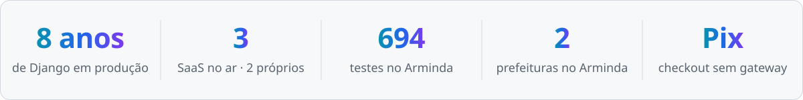
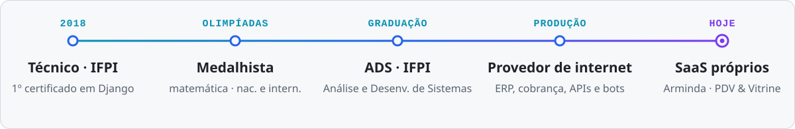

<picture>
  <source media="(prefers-color-scheme: dark)" srcset="./assets/banner-dark.svg">
  
</picture>

  
  
  
  

 

Sou desenvolvedor **full stack** e trabalho em duas frentes. Na primeira, **projeto produtos SaaS do zero**, com teste, CI e decisões de arquitetura registradas. Dois deles já estão em produção com clientes reais. Na segunda, **desenvolvo para um provedor de internet regional**, com integrações, automações e atendimento automatizado.

Comecei com Django em 2018, aos 15 anos, no técnico do IFPI, e uso a mesma stack em produção até hoje. São oito anos aprofundando uma tecnologia só. Meu método é **medir antes de decidir** e **documentar o que não é óbvio**.

<picture>
  <source media="(prefers-color-scheme: dark)" srcset="./assets/metrics-dark.svg">
  
</picture>

## Produtos

<table>
  <tr>
    <td width="50%" valign="top">
      <a href="https://arminda.site">
        <picture>
          <source media="(prefers-color-scheme: dark)" srcset="./assets/card-arminda-dark.svg">
          
        </picture>
      </a>
    </td>
    <td width="50%" valign="top">
      <a href="https://github.com/darlanvelozo/Vape_project">
        <picture>
          <source media="(prefers-color-scheme: dark)" srcset="./assets/card-vape-dark.svg">
          
        </picture>
      </a>
    </td>
  </tr>
  <tr>
    <td width="50%" valign="top">
      <picture>
        <source media="(prefers-color-scheme: dark)" srcset="./assets/card-hubtrix-dark.svg">
        
      </picture>
    </td>
    <td width="50%" valign="top">
      <a href="https://github.com/darlanvelozo/blue_matrics">
        <picture>
          <source media="(prefers-color-scheme: dark)" srcset="./assets/card-bluemetrics-dark.svg">
          
        </picture>
      </a>
    </td>
  </tr>
</table>

<b>Detalhes técnicos de cada produto</b>

 

**Arminda.** É um substituto moderno para os sistemas legados de folha do setor público, com paridade funcional. Prefeituras migram sozinhas por um importador self-service que aceita vários fornecedores de origem. O eSocial está completo até o lote: geração, assinatura, eventos periódicos e transmissão. Cada município fica num schema próprio do PostgreSQL. O cálculo assíncrono roda em Celery + Redis. O front usa Vite, React 18, TypeScript, shadcn/ui e TanStack Query. A aplicação roda em VPS própria com gunicorn, Nginx e systemd. O projeto foi construído em 11 blocos sequenciais e está na `v0.42`.

**PDV & Vitrine.** Cada loja se cadastra sozinha e enxerga só os próprios dados. O sistema cobre PDV com leitor de código de barras e pagamento dividido, caixa com sangria e conferência, estoque com custo médio ponderado e extrato auditável, compras, financeiro e relatórios (curva ABC, giro e margem). No checkout Pix, o próprio sistema gera o BR Code estático do Banco Central e o testa contra o exemplo oficial. O estoque fica reservado com `SELECT … FOR UPDATE`, e há testes para a disputa pela última unidade e para o isolamento entre lojas. O changelog e as ADRs são versionados no repositório.

**Hubtrix.** Sou co-desenvolvedor do core de um SaaS multi-tenant usado por vários provedores. Construí o módulo de **Cobrança** (régua de cobrança e reconquista pós-cancelamento) e o de **Analytics** (jornada do bot de vendas e painel comercial). Também trabalho nas integrações com ERP, WhatsApp e provedores de IA.

**BlueMetrics.** Conecta ao ERP Conta Azul via OAuth2 e sincroniza os dados financeiros e comerciais. O isolamento por tenant é feito com Row-Level Security no PostgreSQL 16. Os insights são gerados pelo Claude e a cobrança passa pela Stripe. O front é em Next.js 15, com Docker e GitHub Actions.

## O que entrego

- **Produtos SaaS do zero ao deploy**: multi-tenant, autenticação e permissões, cobrança, testes, CI e operação em servidor próprio.
- **Integrações com ERPs e APIs de terceiros**: sincronização de dados, gateways de API com controle de acesso e documentação.
- **Automação de processos**: rotinas agendadas, réguas de comunicação e bots de atendimento e vendas no WhatsApp.
- **IA aplicada a produto**: LLMs para geração de insights, validação de documentos e assistentes conversacionais.
- **Dados e BI**: dashboards, indicadores comerciais e financeiros, análise de funil e carteira.
- **Conformidade brasileira**: eSocial, Pix (BR Code) e regras de folha do setor público.

## Onde colaboro

<table>
  <tr>
    <td width="72" align="center"></td>
    <td><b><a href="https://github.com/Megalink-Telecom">Megalink Telecom</a></b> · time de desenvolvimento Desenvolvo funcionalidades e reviso PRs da plataforma interna da empresa.</td>
  </tr>
  <tr>
    <td align="center">🚀</td>
    <td><b>Hubtrix</b> · co-desenvolvedor do core Tenho 190+ commits num SaaS multi-tenant para provedores (Django 5.2, Channels, WebSocket, integração com LLMs).</td>
  </tr>
  <tr>
    <td align="center"></td>
    <td><b><a href="https://github.com/CONSULTECHPI">CONSULTECHPI</a></b> · admin Consultoria em tecnologia. Responsável pelo site institucional.</td>
  </tr>
  <tr>
    <td align="center"></td>
    <td><b><a href="https://github.com/jobstechorg">jobstechorg</a></b> · admin Ferramentas de atendimento.</td>
  </tr>
</table>

Também uso **engenharia assistida por IA** no dia a dia. Montei um painel de revisão de PRs que roda o Claude Code headless, em modo somente leitura, num worktree descartável. Ele confronta a especificação com o diff e só permite aprovar o commit exato que foi analisado.

## Stack

| Profundidade | Tecnologias |
|:--|:--|
| **Opero em produção** |         |
| **Front-end** |        |
| **Qualidade & entrega** |       |
| **IA & integrações** |        |
| **Também uso** |       |

## Trajetória

<picture>
  <source media="(prefers-color-scheme: dark)" srcset="./assets/timeline-dark.svg">
  
</picture>

> Olimpíada não é sobre matemática. É atacar um problema que você não sabe resolver, com tempo contado e sem consultar a resposta. É a mesma habilidade que se usa às duas da manhã com um serviço fora do ar.

## Escrevo sobre isso

Escrevo casos técnicos de integração em provedores de internet, sempre na estrutura **problema → medição → decisão → resultado**.

- [**Quando a API oficial é o caminho errado**](https://github.com/darlanvelozo/engenharia-telecom/blob/main/artigos/api-oficial-caminho-errado.md). Como decidir o caminho de uma integração medindo, e não por preferência.
- [**Sua documentação de API conta demais**](https://github.com/darlanvelozo/engenharia-telecom/blob/main/artigos/documentacao-por-escopo.md). Como filtrar a documentação pelo escopo do token.

 

  Teresina, Piauí · aberto a conversas sobre produto, integrações e consultoria 
  <a href="https://www.linkedin.com/in/darlan-velozo-81b52020a/">LinkedIn</a> ·
  <a href="mailto:darlanveloso14@gmail.com">E-mail</a> ·
  <a href="https://arminda.site">arminda.site</a>

